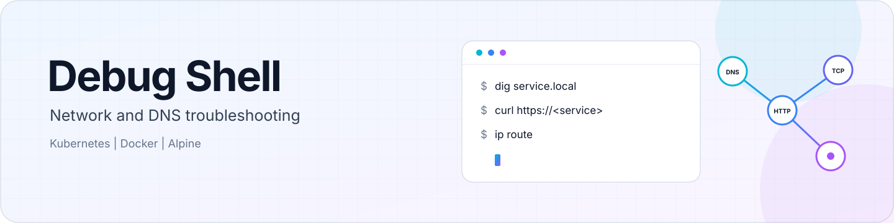

<h1 align="center">
  <picture>
    <source media="(prefers-color-scheme: dark)" srcset="assets/debug-shell-banner-dark.svg">
    
  </picture>
</h1>

<p align="center">
  <a href="https://github.com/michielvha/debug-shell/actions/workflows/release.yml"></a>
  <a href="https://github.com/michielvha/debug-shell/actions/workflows/helm-release.yml"></a>
</p>

Debug Shell is a non-root Alpine-based container for network and DNS troubleshooting in Docker and Kubernetes. It supports `linux/amd64` and `linux/arm64`.

## Included tools

| Area | Tools |
|------|-------|
| DNS | `dig`, `nslookup`, `drill` |
| Connectivity | `ping`, `curl`, `wget`, `nc` |
| Network inspection | `tcpdump`, `nmap`, `netstat`, `ip`, `ss` |
| Process debugging | `strace` |
| Shell | `bash` |

## Use with Docker

```bash
# Start an interactive shell
docker run --rm -it ghcr.io/michielvha/debug-shell:latest

# Share another container's network namespace
docker run --rm -it --network container:<container-name> \
  ghcr.io/michielvha/debug-shell:latest

# Run with host network (Linux only)
docker run --rm -it --network host ghcr.io/michielvha/debug-shell:latest

# For ping, tcpdump, or nmap
docker run --rm -it --cap-add=NET_RAW ghcr.io/michielvha/debug-shell:latest

# For strace
docker run --rm -it --cap-add=SYS_PTRACE ghcr.io/michielvha/debug-shell:latest
```

## Use with Kubernetes

### Helm

```bash
# Install the chart from GHCR
helm install debug-shell oci://ghcr.io/michielvha/charts/debug-shell

# Use the enhanced security profile
helm install debug-shell oci://ghcr.io/michielvha/charts/debug-shell \
  -f https://raw.githubusercontent.com/michielvha/debug-shell/main/deployments/helm/debug-shell/values-enhanced.yaml
```

See the [Helm chart guide](deployments/helm/debug-shell/README.md) for profile details and configuration.

### Kustomize

```bash
# Apply the base configuration
kubectl apply -k https://github.com/michielvha/debug-shell/deployments/kustomize/base

# Apply the enhanced security overlay
kubectl apply -k https://github.com/michielvha/debug-shell/deployments/kustomize/overlays/enhanced-security

# Apply the maximum security overlay
kubectl apply -k https://github.com/michielvha/debug-shell/deployments/kustomize/overlays/maximum-security
```

See the [Kustomize base guide](deployments/kustomize/base/README.md) and the [security overlays](deployments/kustomize/overlays/).

### Ephemeral container

Kubernetes 1.23 and later supports ephemeral containers:

```bash
kubectl debug <pod-name> -it --image=ghcr.io/michielvha/debug-shell:latest --target=<container-name>
```

## Common tasks

### DNS

```bash
dig <service-name>
nslookup <service-name>
drill <service-name>
dig @<dns-server> <service-name>
```

### Connectivity

```bash
ping <service-name>
curl -v https://<service-url>
wget https://<service-url>
nc -zv <service-name> <port>
```

### Network state

```bash
ip addr show
ip route show
netstat -tulpn
ss -tulpn
```

### Process debugging

```bash
strace -p <pid>
```

## Image tags

| Tag | Description | Example |
|-----|-------------|---------|
| `latest` | Most recently published image | `ghcr.io/michielvha/debug-shell:latest` |
| `<version>` | Semantic image version | `ghcr.io/michielvha/debug-shell:<version>` |
| `<full-commit-sha>` | Full source commit SHA | `ghcr.io/michielvha/debug-shell:<full-commit-sha>` |

Git tags use a `v` prefix. Image and chart tags use the same semantic version without it. For example, Git tag `vX.Y.Z` maps to image and chart version `X.Y.Z`.

## Security

The image runs as UID and GID 1000. The Dockerfile sets `NET_RAW` file capabilities on `ping`, `tcpdump`, and `nmap`. Ping is not setuid, and BusyBox has no file capabilities.

Those tools need the runtime to make `NET_RAW` effective. Docker's `no-new-privileges` setting prevents the non-root process from acquiring it through file capabilities, even when the container is started with `--cap-add=NET_RAW`. Runtime behavior can differ, so check effective capabilities when these tools are unavailable. `strace` requires `SYS_PTRACE`.

The Helm chart's moderate profile is the default. It drops all capabilities, adds `NET_RAW`, disallows privilege escalation, uses the `RuntimeDefault` seccomp profile, and sets resource requests and limits. Enhanced uses a read-only filesystem and keeps `NET_RAW`; maximum uses a read-only filesystem and no capabilities, which disables `ping`, `tcpdump`, `nmap`, and `strace`. See the [Helm chart guide](deployments/helm/debug-shell/README.md) and [Kustomize security overlays](deployments/kustomize/overlays/).

Before publication, the container release workflow runs smoke tests and scans the image with Trivy. The scan blocks publication for CRITICAL, HIGH, or MEDIUM findings. See the [container release workflow](.github/workflows/release.yml).

The release workflow signs image digests, not tags, with keyless Cosign signing through GitHub OIDC. Verify an image by digest:

```bash
cosign verify \
  --certificate-identity-regexp "https://github.com/michielvha/debug-shell/.*" \
  --certificate-oidc-issuer "https://token.actions.githubusercontent.com" \
  ghcr.io/michielvha/debug-shell@sha256:<digest>
```

## Release versioning

Both release workflows use the configuration bundled with the SHA-pinned
`gitversion-tag-action`, without a repository-specific GitVersion file.

## Test a local image

Build the image and run its smoke tests:

```bash
docker build -t debug-shell:test .
bash tests/image-smoke.sh debug-shell:test
```

The smoke tests check the image as UID 1000 under read-only and capability-restricted
runtime configurations. The container release workflow runs them before scanning
and publication.

## Support

For issues, questions, or contributions, [open an issue](https://github.com/michielvha/debug-shell/issues).